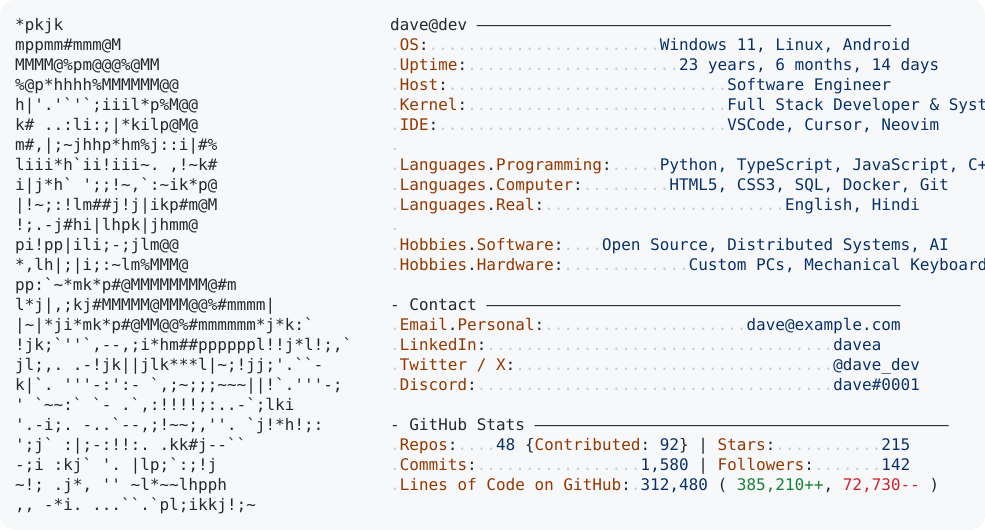

# Hi there, I'm Dave 👋

  <picture>
    <source media="(prefers-color-scheme: dark)" srcset="./dark_mode.svg">
    
  </picture>

 

### 🛠️ Tech Stack & Tools
- **Languages:** Python, TypeScript, JavaScript, C++, SQL
- **Platforms & Tools:** Docker, Git, Linux, Windows Terminal, VSCode
- **Interests:** High-Performance Systems, Open Source, Full-Stack Architecture

---

<b>⚙️ How This Auto-Updating Profile Card Works</b>

 

This GitHub Profile README reproduces the sleek Neofetch terminal style:
1. **ASCII Art Portrait:** Rendered directly from your photo, preserving glasses, beard, and contours.
2. **Auto-updating Stats (`today.py`):** Runs daily at midnight UTC via GitHub Actions (`.github/workflows/build.yaml`) to calculate your live GitHub statistics (stars, commits, repositories, followers, lines of code additions/deletions) and age/uptime.
3. **Adaptive Dark / Light Themes:** Uses `<picture>` media query tags to seamlessly match the viewer's GitHub color mode.

#### Quick Setup Steps:
1. Create a special repository matching your GitHub username (e.g., `username/username`).
2. Place these files in the root:
   - `README.md`
   - `dark_mode.svg`
   - `light_mode.svg`
   - `today.py`
   - `.github/workflows/build.yaml`
3. Generate a GitHub Personal Access Token (PAT) with `read:user`, `repo`, and `read:org` permissions.
4. In your repository, go to **Settings → Secrets and variables → Actions** and add:
   - `ACCESS_TOKEN`: Your GitHub PAT.
   - `USER_NAME`: Your GitHub username.
5. Push to `main`, and your GitHub profile is live!

