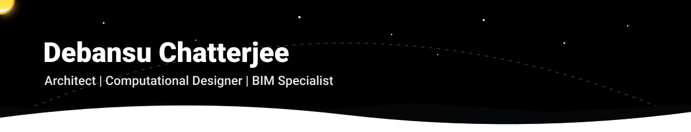
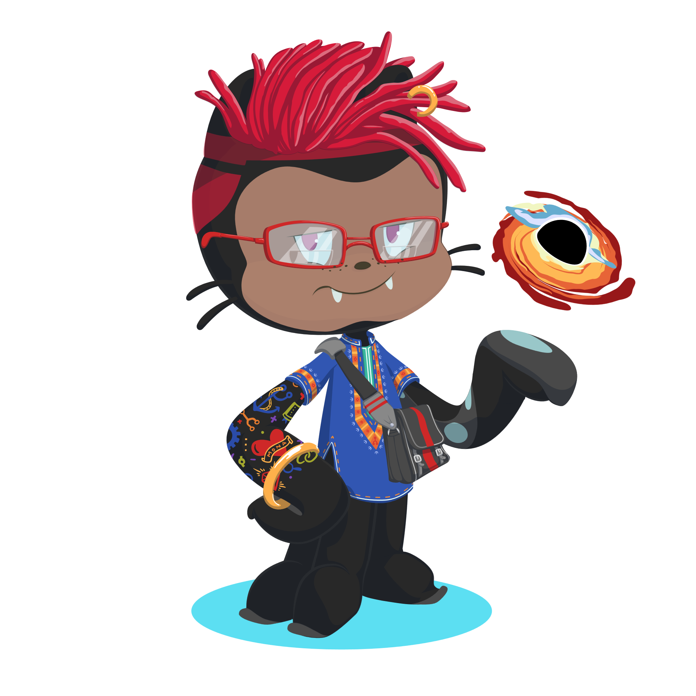

<!-- Custom Day/Night Animated Banner -->

<!-- Enlarged Custom Octocat Locked to the Right Box Height -->

<!-- Left-Aligned Header Controls -->
<h3>
  
  <b>System.Initialize("Escanor-sinofpride")</b>
  
</h3>

<!-- Typing Terminal -->

 

<!-- Brown-crossed divider line completely removed -->

<h3 style="font-family: 'Roboto', sans-serif;">
   Computational Stack & Automation Pipeline
</h3>

*  **Generative Modeling:**&nbsp;Rhinoceros&nbsp;8,&nbsp;Grasshopper,&nbsp;Beegraphy,&nbsp;Kangaroo&nbsp;Physics
*  **BIM & API Automation:**&nbsp;Autodesk&nbsp;Revit,&nbsp;Python&nbsp;(`pyRevit`/`RevitAPI`),&nbsp;C#,&nbsp;Navisworks
*  **Environmental Performance:**&nbsp;Ladybug&nbsp;Tools,&nbsp;Honeybee,&nbsp;Solar&nbsp;&&nbsp;Daylight&nbsp;Rationalization
*  **Reality Capture & AI:**&nbsp;3D&nbsp;LiDAR&nbsp;Point&nbsp;Clouds,&nbsp;Drone&nbsp;Photogrammetry,&nbsp;Local&nbsp;LLM&nbsp;/&nbsp;MCP

 

  
  
  
  
  
  

<!-- Full-Width Animated Neon RGB Line Divider -->

<h3 style="font-family: 'Roboto', sans-serif;" align="center">
   GitHub Activity & Telemetry
</h3>

  
  

<!-- Full-Width Animated Neon RGB Line Divider -->

